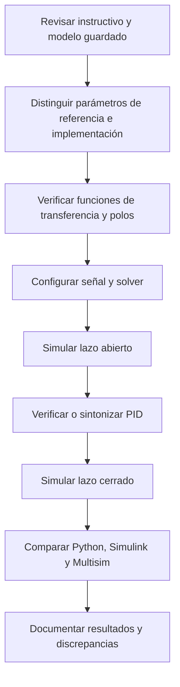

[](https://matlab.mathworks.com/)

# Práctica 2 — Sistema cardiovascular

## Información de la estudiante

**Emiliano Villalobos García** · **23212243** · **l23212243@tectijuana.edu.mx**

**Asignatura:** Modelado de Sistemas Fisiológicos (IBF-1020)  
**Programa:** Ingeniería Biomédica

## Docente

**Dr. Paul Antonio Valle Trujillo** · paul.valle@tectijuana.edu.mx  
Departamento de Ingeniería Eléctrica y Electrónica, Tecnológico Nacional de México / Instituto Tecnológico de Tijuana, Blvd. Alberto Limón Padilla s/n, Tijuana, C.P. 22454, B.C., México.

---

<a id="contenido"></a>
## Contenido

1. [Resumen](#resumen)
2. [Competencia y objetivos](#objetivos)
3. [Relación con el temario](#temario)
4. [Modelo físico y analogía eléctrica](#analogia)
5. [Formulación matemática](#modelo)
6. [Parámetros: instructivo e implementación](#parametros)
7. [Análisis temporal y de estabilidad](#analisis)
8. [Señales y configuración de simulación](#senales)
9. [Implementación en Python, Simulink y Multisim](#implementacion)
10. [Control PID](#pid)
11. [Resultados y verificación](#resultados)
12. [Flujo de trabajo](#flujo)
13. [Actividades y entregables](#actividades)
14. [Estructura del repositorio](#estructura)
15. [Requisitos, reproducibilidad y referencias](#reproducibilidad)
16. [Uso académico](#uso-academico)

---

<a id="resumen"></a>
## Resumen

Esta práctica representa la dinámica arterial mediante un modelo Windkessel de cuatro elementos: impedancia característica proximal $Z$, inertancia arterial $L$, distensibilidad arterial $C$ y resistencia periférica $R$. La entrada es la presión arterial $P_a(t)$ y la salida es la presión sobre la distensibilidad arterial $P_p(t)$.

Se desarrolla la función de transferencia, el modelo de estados, el análisis de estabilidad y la comparación de tres condiciones: hipotenso, normotenso e hipertenso. Se incluyen los coeficientes, controladores PID y opciones de simulación extraídos del modelo `Sistema1.slx`.

> **Trazabilidad:** el instructivo proporciona los parámetros fisiológicos de referencia; el archivo `Sistema1.slx` implementa otro conjunto numérico. Ambos se conservan y se distinguen en este documento. Los resultados obtenidos con el modelo corresponden a la implementación, no a una sustitución silenciosa de los parámetros oficiales.

**Palabras clave:** Windkessel; sistema cardiovascular; presión arterial; PID; Simulink; Python; Multisim; simulación *in silico*.

[Volver al contenido](#contenido)

---

<a id="objetivos"></a>
## Competencia y objetivos

### Competencia a desarrollar

Aplicar herramientas de modelado matemático, simulación y control retroalimentado para describir la dinámica de un sistema cardiovascular mediante un modelo Windkessel de cuatro elementos.

### Objetivo general

Obtener, analizar y simular el modelo Windkessel, comparando los casos hipotenso, normotenso e hipertenso en lazo abierto y con control PID.

### Objetivos específicos

1. Identificar entrada, salida, flujos y parámetros hemodinámicos del modelo.
2. Obtener la función de transferencia $P_p(s)/P_a(s)$ y el modelo de estados.
3. Determinar estabilidad y error estacionario en lazo abierto.
4. Comparar los parámetros oficiales con los realmente empleados en Simulink.
5. Reproducir las respuestas en Python, Simulink y Multisim.
6. Documentar la sintonización PID y comparar lazo abierto contra lazo cerrado.
7. Elaborar un diagrama biológico en BioRender y un reporte de resultados *in silico*.

[Volver al contenido](#contenido)

---

<a id="temario"></a>
## Relación con el temario

| Unidad | Área | Contenidos aplicados |
|---|---|---|
| I | Sistemas de control retroalimentados | Diagramas de bloques, estabilidad, error estacionario y retroalimentación negativa |
| II | Modelado matemático | Analogía hidráulica-eléctrica, estados, ecuaciones diferenciales y funciones de transferencia |
| III | Controladores | PID y sintonización mediante PID Tuner |

[Volver al contenido](#contenido)

---

<a id="analogia"></a>
## Modelo físico y analogía eléctrica

La topología analizada tiene $Z$ y $L$ en paralelo entre $P_a(t)$ y $P_p(t)$; $R$ y $C$ están en paralelo desde $P_p(t)$ a la referencia. Los dos elementos dinámicos, $L$ y $C$, justifican el orden dos del sistema.

| Símbolo | Equivalente eléctrico | Interpretación fisiológica |
|---|---|---|
| $P_a(t)$ | Voltaje de entrada | Presión arterial de entrada |
| $P_p(t)$ | Voltaje de salida | Presión sobre la distensibilidad arterial |
| $F_a(t)$ | Corriente de entrada | Flujo hacia aorta o arteria pulmonar |
| $F_Z(t)$ | Corriente por $Z$ | Flujo asociado a la impedancia proximal |
| $F_L(t)$ | Corriente por $L$ | Flujo por inertancia arterial |
| $F_C(t)$ | Corriente por $C$ | Flujo almacenado en la distensibilidad |
| $F_R(t)$ | Corriente por $R$ | Flujo periférico |
| $Z$ | Resistencia | Impedancia característica proximal |
| $C$ | Capacitor | Distensibilidad arterial total |
| $R$ | Resistencia | Resistencia periférica |
| $L$ | Inductor | Inertancia arterial |

> El instructivo contiene la expresión “distensibilidad aérea total”; por el contexto y la topología, aquí se usa “distensibilidad arterial total”.

[Volver al contenido](#contenido)

---

<a id="modelo"></a>
## Formulación matemática

Definiendo $\Delta P(t)=P_a(t)-P_p(t)$, las ecuaciones de las ramas son:

$$F_Z(t)=\frac{P_a(t)-P_p(t)}{Z}$$

$$L\frac{dF_L(t)}{dt}=P_a(t)-P_p(t)$$

$$F_C(t)=C\frac{dP_p(t)}{dt},\qquad F_R(t)=\frac{P_p(t)}{R}$$

Por conservación de flujo:

$$F_a(t)=F_Z(t)+F_L(t)=F_C(t)+F_R(t)$$

Con $x_1(t)=F_L(t)$ y $x_2(t)=P_p(t)$, el modelo de estados es:

$$\dot F_L(t)=\frac{P_a(t)-P_p(t)}{L}$$

$$\dot P_p(t)=\frac{1}{C}\left[\frac{P_a(t)-P_p(t)}{Z}+F_L(t)-\frac{P_p(t)}{R}\right]$$

La impedancia equivalente entre la entrada y el nodo de salida es:

$$Z_{\mathrm{serie}}(s)=Z\parallel Ls=\frac{ZLs}{Z+Ls}$$

La impedancia de carga es:

$$Z_{\mathrm{carga}}(s)=R\parallel\frac{1}{Cs}=\frac{R}{RCs+1}$$

Aplicando divisor de impedancias:

$$\frac{P_p(s)}{P_a(s)}=\frac{Z_{\mathrm{carga}}(s)}{Z_{\mathrm{serie}}(s)+Z_{\mathrm{carga}}(s)}$$

Por tanto:

$$\boxed{G(s)=\frac{P_p(s)}{P_a(s)}=\frac{LRs+RZ}{CLRZs^2+L(Z+R)s+RZ}}$$

El cero finito es $s_z=-Z/L$.

> **Caveat de topología:** esta ecuación sólo es válida para $Z\parallel L$ entre $P_a$ y $P_p$, y $R\parallel C$ desde $P_p$ a referencia. Otra conexión produce otra función de transferencia.

[Volver al contenido](#contenido)

---

<a id="parametros"></a>
## Parámetros: instructivo e implementación

### Parámetros de referencia del instructivo

| Caso | $Z$ | $C$ | $R$ | $L$ |
|---|---:|---:|---:|---:|
| Hipotenso | 0.020 | 0.250 | 0.600 | 0.005 |
| Normotenso | 0.033 | 1.500 | 0.950 | 0.010 |
| Hipertenso | 0.050 | 2.500 | 1.400 | 0.020 |

Unidades: $Z,R$ en $\mathrm{mmHg\,s/ml}$, $C$ en $\mathrm{ml/mmHg}$ y $L$ en $\mathrm{mmHg\,s^2/ml}$.

### Parámetros implementados en `Sistema1.slx`

El modelo guardado emplea $Z=0.010$, $L=0.001$ y $R=1.000$ en las tres plantas. Sólo varía $C$.

| Caso en el modelo | $Z$ | $C$ | $R$ | $L$ |
|---|---:|---:|---:|---:|
| Hipotenso | 0.010 | 3.500 | 1.000 | 0.001 |
| Normotenso | 0.010 | 1.500 | 1.000 | 0.001 |
| Hipertenso | 0.010 | 1.000 | 1.000 | 0.001 |

> **Discrepancia relevante:** estos valores no coinciden con los parámetros fisiológicos del instructivo. Las funciones, polos y PID de las secciones siguientes son los almacenados en `Sistema1.slx`.

> **Etiqueta del archivo:** el subsistema externo denominado `Sistema: Hipotenso1` contiene internamente la planta y la salida `Pp(t):Hipertenso`; se documenta como caso hipertenso en este README.

### Funciones de transferencia implementadas

| Caso | $G(s)=P_p(s)/P_a(s)$ |
|---|---|
| Hipotenso | $\displaystyle\frac{0.001s+0.01}{3.5\times10^{-5}s^2+0.00101s+0.01}$ |
| Normotenso | $\displaystyle\frac{0.001s+0.01}{1.5\times10^{-5}s^2+0.00101s+0.01}$ |
| Hipertenso | $\displaystyle\frac{0.001s+0.01}{1.0\times10^{-5}s^2+0.00101s+0.01}$ |

[Volver al contenido](#contenido)

---

<a id="analisis"></a>
## Análisis temporal y de estabilidad

Para un escalón unitario, $G(0)=1$ en las tres funciones implementadas. Por tanto, bajo condiciones iniciales nulas y estabilidad:

$$\boxed{e_{ss}=0}$$

Los polos obtenidos con los coeficientes del modelo son:

| Caso | Polos $\mathrm{(s^{-1})}$ | Clasificación |
|---|---|---|
| Hipotenso | $-14.4286\pm j\,8.8051$ | Estable, subamortiguado |
| Normotenso | $-12.0616,\;-55.2717$ | Estable, sobreamortiguado |
| Hipertenso | $-11.1268,\;-89.8732$ | Estable, sobreamortiguado |

Todos los polos tienen parte real negativa; los tres sistemas implementados son estables en lazo abierto.

[Volver al contenido](#contenido)

---

<a id="senales"></a>
## Señales y configuración de simulación

Configuración extraída del cuaderno y del modelo:

| Elemento | Valor |
|---|---:|
| Tiempo final | $15\,\mathrm{s}$ |
| Solver | `ode15s` |
| Paso máximo | $1\times10^{-2}\,\mathrm{s}$ |
| Señal | `Uniform Random Number` |
| Mínimo | $-0.2\,\mathrm{V}$ |
| Semilla | 106 |
| Tiempo de muestreo aplicado | $0.1\,\mathrm{s}$ |
| Máximo | `[PENDIENTE: confirmar en la interfaz; no está serializado explícitamente]` |

El instructivo especifica $T_s=0.5\,\mathrm{s}$ y máximo $1\,\mathrm{V}$. El modelo actualmente utiliza $T_s=0.1\,\mathrm{s}$; esta diferencia debe declararse o corregirse antes de comparar resultados contra el procedimiento oficial.

[Volver al contenido](#contenido)

---

<a id="implementacion"></a>
## Implementación en Python, Simulink y Multisim

| Plataforma | Implementación | Verificación mínima |
|---|---|---|
| Simulink | Archivo `Sistema1.slx` | Coeficientes, PID, señal y solver documentados |
| Python | `scipy.signal.TransferFunction` o espacio de estados | Usar exactamente los coeficientes seleccionados |
| Multisim | Circuito análogo con escala explícita | Mantener topología $Z\parallel L$ y $R\parallel C$ |

Para comparar plataformas deben usarse los mismos parámetros, entrada, semilla, periodo de muestreo, escala y horizonte temporal. La conversión de variables hemodinámicas a componentes eléctricos en Multisim requiere un factor de escala documentado.

[Volver al contenido](#contenido)

---

<a id="pid"></a>
## Control PID

El archivo `Sistema1.slx` contiene dos controladores PID continuos de forma paralela, sintonizados con **Transfer Function Based (PID Tuner App)**. Ambos tienen filtro derivativo activado y $N=52097.4866681572$.

| Caso controlado | $k_P$ | $k_I$ | $k_D$ |
|---|---:|---:|---:|
| Hipotenso | 477.1555564974 | 1204530.19400615 | 0.00626997867136255 |
| Hipertenso | 136.484082396112 | 344859.463010369 | 0.00174922963731476 |

La forma ideal del controlador es:

$$K(s)=k_P+\frac{k_I}{s}+k_Ds$$

Para retroalimentación negativa unitaria:

$$T(s)=\frac{K(s)G(s)}{1+K(s)G(s)}$$

No se reportan métricas de desempeño sin una simulación verificable y las gráficas correspondientes.

[Volver al contenido](#contenido)

---

<a id="resultados"></a>
## Resultados y verificación

| Tipo de contenido | Criterio |
|---|---|
| Referencia | Parámetros y actividades del instructivo |
| Implementación existente | Datos extraídos de `Sistema1.slx` y `Villlalobos23212243.mlx` |
| Resultado propio | Gráfica o métrica reproducida con fecha, versión y configuración |
| Pendiente | Debe marcarse como `[PENDIENTE]` |

| Caso | Lazo | Archivo o figura | Estado |
|---|---|---|---|
| Hipotenso | Abierto | `[PENDIENTE]` | Pendiente de exportar gráfica verificable |
| Hipotenso | Cerrado | `[PENDIENTE]` | Pendiente de exportar gráfica verificable |
| Normotenso | Abierto | `[PENDIENTE]` | Pendiente de exportar gráfica verificable |
| Hipertenso | Abierto | `[PENDIENTE]` | Pendiente de exportar gráfica verificable |
| Hipertenso | Cerrado | `[PENDIENTE]` | Pendiente de exportar gráfica verificable |

[Volver al contenido](#contenido)

---

<a id="flujo"></a>
## Flujo de trabajo



[Volver al contenido](#contenido)

---

<a id="actividades"></a>
## Actividades y entregables

- [ ] Verificar cuál conjunto de parámetros debe emplearse como resultado final: instructivo o modelo guardado.
- [ ] Confirmar el máximo de la señal aleatoria en Simulink.
- [ ] Corregir $T_s$ a $0.5\,\mathrm{s}$ si se debe cumplir literalmente el instructivo.
- [ ] Exportar gráficas de lazo abierto y cerrado.
- [ ] Reproducir las funciones implementadas en Python.
- [ ] Construir el equivalente escalado en Multisim.
- [ ] Elaborar el diagrama biológico en BioRender.
- [ ] Integrar discusión, capturas y reporte final.

[Volver al contenido](#contenido)

---

<a id="estructura"></a>
## Estructura del repositorio

```text
practica-2-windkessel/
├── README.md
├── matlab/
│   ├── Sistema1.slx
│   └── Villlalobos23212243.mlx
├── python/
│   └── windkessel_p2.py
├── multisim/
│   └── practica2_windkessel.ms14
├── biorender/
│   └── diagrama_biologico.png
├── resultados/
│   ├── lazo_abierto/
│   └── lazo_cerrado/
└── reporte/
    └── practica2_reporte.pdf
```

[Volver al contenido](#contenido)

---

<a id="reproducibilidad"></a>
## Requisitos, reproducibilidad y referencias

### Requisitos

- MATLAB y Simulink con Control System Toolbox.
- Python 3.10 o superior con `numpy`, `scipy` y `matplotlib`.
- Multisim compatible con el archivo de circuito.
- BioRender para el diagrama biológico.

### Reproducibilidad

Registrar en cada simulación: función de transferencia, parámetros, entrada, semilla, periodo de muestreo, solver, paso máximo, ganancias PID, versión del software y fecha de ejecución.

### Referencias

1. P. A. Valle, *Práctica: Sistema cardiovascular*, Modelado de Sistemas Fisiológicos, TecNM / Instituto Tecnológico de Tijuana.
2. T. Kind, T. J. Faes, J. W. Lankhaar, A. Vonk-Noordegraaf y M. Verhaegen, “Estimation of three- and four-element windkessel parameters using subspace model identification”, *IEEE Transactions on Biomedical Engineering*, vol. 57, no. 7, pp. 1531-1538, 2010. https://doi.org/10.1109/TBME.2010.2041351
3. M. C. Khoo, *Physiological Control Systems: Analysis, Simulation, and Estimation*, 2nd ed., IEEE Press, 2018.
4. N. S. Nise, *Control Systems Engineering*, 8th ed., John Wiley & Sons, 2020.

[Volver al contenido](#contenido)

---

<a id="uso-academico"></a>
## Uso académico

Este repositorio tiene fines académicos. La asistencia de IA debe declararse conforme a las indicaciones del docente. Los parámetros oficiales, la implementación existente, los resultados reproducidos y las modificaciones propias deben mantenerse claramente diferenciados.

El modelo Windkessel es una aproximación educativa; no constituye una herramienta de diagnóstico ni de toma de decisiones clínicas.
