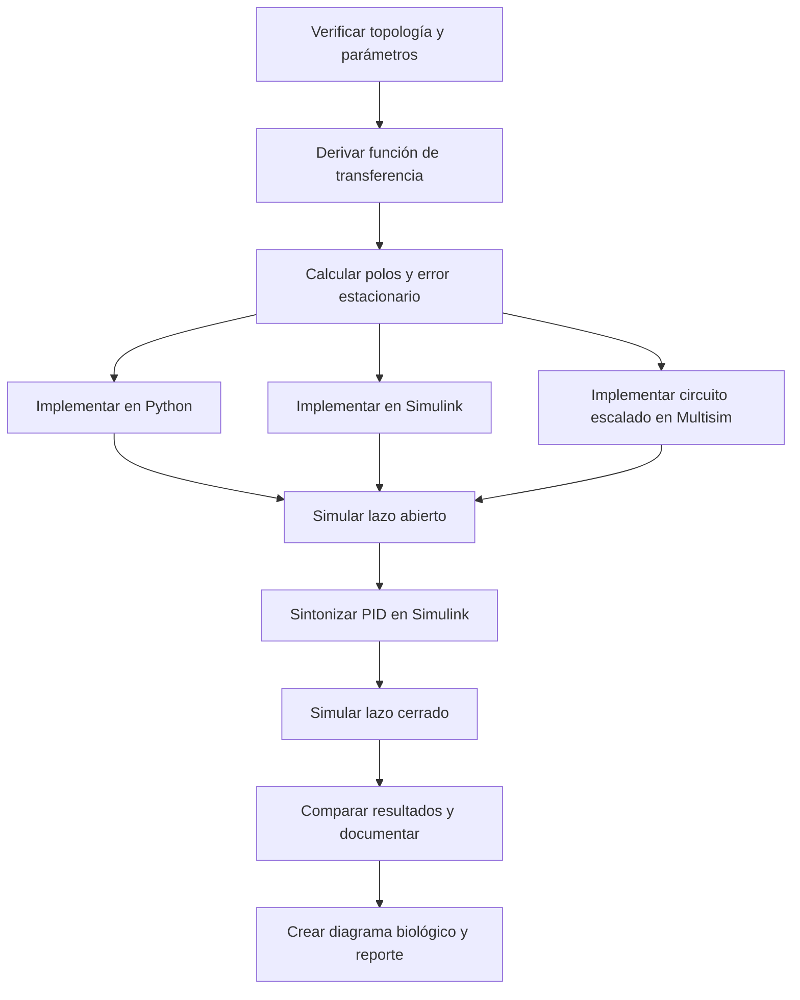

[](https://matlab.mathworks.com/)

# Práctica 2 — Sistema cardiovascular

## Información de la estudiante

Emiliano Villalobos García · [23212243] · l23212243@tijuana.tecnm.mx

**Asignatura:** Modelado de Sistemas Fisiológicos (IBF-1020)  
**Programa:** Ingeniería Biomédica  

## Docente

**Dr. Paul Antonio Valle Trujillo** · paul.valle@tectijuana.edu.mx  

Departamento de Ingeniería Eléctrica y Electrónica, Tecnológico Nacional de México / Instituto Tecnológico de Tijuana, Blvd. Alberto Limón Padilla s/n, Tijuana, C.P. 22454, B.C., México.

## Descripción de la asignatura

El modelado de sistemas fisiológicos permite representar cuantitativamente procesos biológicos mediante modelos matemáticos, computacionales y analogías físicas. En Ingeniería Biomédica, estas herramientas ayudan a estudiar la dinámica de sistemas complejos, analizar su estabilidad, evaluar respuestas temporales y diseñar estrategias de control.

La asignatura integra fundamentos de Ingeniería de Control, Electrónica Analógica, Ciencias de la Computación, Anatomía y Fisiología. En esta práctica se emplea un modelo Windkessel de cuatro elementos para describir la dinámica hemodinámica arterial y comparar el comportamiento de un individuo normotenso con casos hipotenso e hipertenso mediante simulación *in silico*.

---

<a id="contenido"></a>
## Contenido

1. [Resumen](#resumen)
2. [Competencia y objetivos](#objetivos)
3. [Relación con el temario](#temario)
4. [Modelo físico y analogía eléctrica](#analogia)
5. [Formulación matemática](#modelo)
6. [Análisis temporal y de estabilidad](#analisis)
7. [Señales de entrada y condiciones de simulación](#senales)
8. [Implementación en Python, Simulink y Multisim](#implementacion)
9. [Control en lazo cerrado y sintonización PID](#pid)
10. [Resultados y verificación cruzada](#resultados)
11. [Flujo de trabajo](#flujo)
12. [Actividades del estudiante](#actividades)
13. [Lista de archivos incluidos](#archivos)
14. [Estructura sugerida del repositorio](#estructura)
15. [Requisitos](#requisitos)
16. [Reproducibilidad y entregables](#reproducibilidad)
17. [Referencias](#referencias)
18. [Uso académico](#uso-academico)

---

<a id="resumen"></a>
## Resumen

La práctica estudia el sistema cardiovascular mediante un modelo Windkessel de cuatro elementos: impedancia característica proximal $Z$, distensibilidad arterial $C$, resistencia periférica $R$ e inertancia arterial $L$. La entrada es la presión arterial $P_a(t)$ y la salida es la presión sobre la distensibilidad arterial $P_p(t)$.

Se obtiene la función de transferencia del sistema, se analiza el error en estado estacionario y la estabilidad en lazo abierto, y se calculan los polos para los casos hipotenso, normotenso e hipertenso. También se propone la simulación del modelo en Python, Simulink y Multisim, así como la sintonización de un controlador PID en Simulink.

Esta práctica es de simulación *in silico*. No se declaran resultados de simulación, ganancias PID, métricas transitorias ni montajes físicos que no hayan sido obtenidos y documentados por la estudiante.

**Palabras clave:** Windkessel; sistema cardiovascular; presión arterial; distensibilidad arterial; resistencia periférica; inertancia arterial; PID; Simulink; Python; Multisim.

[Volver al contenido](#contenido)

---

<a id="objetivos"></a>
## Competencia y objetivos

### Competencia a desarrollar

Aplicar herramientas de modelado matemático, análisis de sistemas dinámicos, simulación y control retroalimentado para representar la dinámica de un sistema fisiológico cardiovascular mediante un modelo Windkessel de cuatro elementos.

### Objetivo general

Obtener, analizar y simular el modelo Windkessel de cuatro elementos para comparar la respuesta de los casos hipotenso, normotenso e hipertenso, en lazo abierto y en lazo cerrado con un controlador PID.

### Objetivos específicos

1. Identificar la entrada, salida, flujos y parámetros hemodinámicos del modelo.
2. Calcular analíticamente la función de transferencia $P_p(s)/P_a(s)$.
3. Obtener el modelo mediante ecuaciones diferenciales de primer orden.
4. Determinar el error en estado estacionario y la estabilidad en lazo abierto.
5. Calcular los polos para los tres casos clínicos proporcionados.
6. Construir el diagrama de bloques de control solicitado.
7. Sintonizar $k_P$, $k_I$ y $k_D$ con el bloque **PID Controller** y PID Tuner en Simulink.
8. Simular la respuesta entre $0$ y $15\,\mathrm{s}$ en Python, Simulink y Multisim.
9. Comparar lazo abierto y lazo cerrado para cada caso.
10. Elaborar un diagrama biológico del sistema con BioRender.
11. Documentar claramente los resultados de referencia, propios y pendientes.

[Volver al contenido](#contenido)

---

<a id="temario"></a>
## Relación con el temario

| Unidad | Área | Contenidos aplicados |
|---|---|---|
| I | Sistemas de control retroalimentados | Diagramas de bloques, respuesta temporal, estabilidad, error estacionario y retroalimentación negativa |
| II | Modelado matemático | Analogía hidráulica-eléctrica, variables de estado, ecuaciones diferenciales y función de transferencia |
| III | Controladores | Control PID y sintonización de ganancias |

[Volver al contenido](#contenido)

---

<a id="analogia"></a>
## Modelo físico y analogía eléctrica

El modelo Windkessel de cuatro elementos representa la dinámica principal de la vasculatura arterial. Posee dos elementos que almacenan energía: la inertancia $L$ y la distensibilidad $C$; por ello requiere dos variables de estado.

La topología indicada es:

- $Z$ y $L$ están en paralelo entre $P_a(t)$ y el nodo de salida $P_p(t)$.
- $C$ y $R$ están en paralelo entre $P_p(t)$ y la referencia.
- La salida es la presión $P_p(t)$.

| Símbolo | Equivalente eléctrico | Interpretación fisiológica |
|---|---|---|
| $P_a(t)$ | Voltaje de entrada | Presión arterial de entrada |
| $P_p(t)$ | Voltaje de salida | Presión sobre la distensibilidad arterial |
| $F_a(t)$ | Corriente de entrada | Flujo hacia la aorta o arteria pulmonar |
| $F_Z(t)$ | Corriente por $Z$ | Flujo asociado a la impedancia proximal |
| $F_L(t)$ | Corriente por $L$ | Flujo por la inertancia arterial |
| $F_C(t)$ | Corriente por $C$ | Flujo almacenado por distensibilidad |
| $F_R(t)$ | Corriente por $R$ | Flujo periférico |
| $Z$ | Resistencia | Impedancia característica proximal |
| $C$ | Capacitor | Distensibilidad arterial total |
| $R$ | Resistencia | Resistencia periférica |
| $L$ | Inductor | Inertancia arterial |

> **Nota:** el instructivo usa la expresión “distensibilidad aérea total”; en este README se emplea “distensibilidad arterial total”, pues corresponde al contexto cardiovascular y a la topología del modelo.

### Parámetros de referencia

| Caso | $Z$ ($\mathrm{mmHg\,s/ml}$) | $C$ ($\mathrm{ml/mmHg}$) | $R$ ($\mathrm{mmHg\,s/ml}$) | $L$ ($\mathrm{mmHg\,s^2/ml}$) |
|---|---:|---:|---:|---:|
| Hipotenso | 0.020 | 0.250 | 0.600 | 0.005 |
| Normotenso (control) | 0.033 | 1.500 | 0.950 | 0.010 |
| Hipertenso | 0.050 | 2.500 | 1.400 | 0.020 |

[Volver al contenido](#contenido)

---

<a id="modelo"></a>
## Formulación matemática

### Ecuaciones constitutivas

Definiendo la diferencia de presión:

$$
\Delta P(t)=P_a(t)-P_p(t),
$$

los flujos en cada rama son:

$$
F_Z(t)=\frac{P_a(t)-P_p(t)}{Z},
$$

$$
L\frac{dF_L(t)}{dt}=P_a(t)-P_p(t),
$$

$$
F_C(t)=C\frac{dP_p(t)}{dt},
\qquad
F_R(t)=\frac{P_p(t)}{R}.
$$

Por conservación de flujo:

$$
F_a(t)=F_Z(t)+F_L(t)=F_C(t)+F_R(t).
$$

### Modelo de ecuaciones diferenciales

Tomando como estados:

$$
x_1(t)=F_L(t),
\qquad
x_2(t)=P_p(t),
$$

se obtiene:

$$
\boxed{
\begin{aligned}
\dot F_L(t)&=\frac{P_a(t)-P_p(t)}{L},\\
\dot P_p(t)&=\frac{1}{C}\left[
\frac{P_a(t)-P_p(t)}{Z}
+F_L(t)
-\frac{P_p(t)}{R}
\right],\\
y(t)&=P_p(t).
\end{aligned}
}
$$

### Función de transferencia

La impedancia equivalente de la rama entre $P_a(t)$ y $P_p(t)$ es:

$$Z_{\mathrm{serie}}(s)=Z\parallel Ls=\frac{ZLs}{Z+Ls}$$

La impedancia de carga formada por $R$ y $C$ es:

$$Z_{\mathrm{carga}}(s)=R\parallel\frac{1}{Cs}=\frac{R}{RCs+1}$$

Aplicando el divisor de impedancias:

$$\frac{P_p(s)}{P_a(s)}=\frac{Z_{\mathrm{carga}}(s)}{Z_{\mathrm{serie}}(s)+Z_{\mathrm{carga}}(s)}$$

Al simplificar:

$$\boxed{G(s)=\frac{P_p(s)}{P_a(s)}=\frac{LRs+RZ}{CLRZs^2+L(Z+R)s+RZ}}$$

El cero finito del sistema se localiza en:

$$
s_z=-\frac{Z}{L}.
$$

> **Caveat de topología:** la función de transferencia anterior es válida únicamente si $Z$ y $L$ están en paralelo entre $P_a$ y $P_p$, y $R$ y $C$ están en paralelo desde $P_p$ a referencia. Un cambio en esa topología o en el punto de medición modifica el modelo.

### Funciones de transferencia de los tres casos

| Caso | Función de transferencia |
|---|---|
| Hipotenso | $\displaystyle G_H(s)=\frac{0.003s+0.012}{1.5\times10^{-5}s^2+0.0031s+0.012}$ |
| Normotenso | $\displaystyle G_N(s)=\frac{0.0095s+0.03135}{4.7025\times10^{-4}s^2+0.00983s+0.03135}$ |
| Hipertenso | $\displaystyle G_{HT}(s)=\frac{0.028s+0.070}{0.0035s^2+0.029s+0.070}$ |

[Volver al contenido](#contenido)

---

<a id="analisis"></a>
## Análisis temporal y de estabilidad

### Error en estado estacionario

Para una entrada escalón unitario:

$$
P_a(s)=\frac{1}{s}.
$$

La ganancia estática de la planta es:

$$
G(0)=\frac{RZ}{RZ}=1.
$$

Por el teorema del valor final:

$$
\lim_{t\to\infty}P_p(t)=1.
$$

Por tanto, el error entre la entrada y la salida para un escalón unitario en lazo abierto es:

$$
\boxed{e_{ss}=0.}
$$

Este resultado sólo es válido para una entrada escalón y el modelo ideal. No implica seguimiento perfecto de una señal aleatoria o variable en el tiempo.

### Polos y estabilidad

Los polos se obtienen del denominador:

$$
CLRZs^2+L(Z+R)s+RZ=0.
$$

| Caso | Polos ($\mathrm{s^{-1}}$) | Comportamiento |
|---|---|---|
| Hipotenso | $-3.9463,\;-202.7203$ | Estable y sobreamortiguado |
| Normotenso | $-3.9269,\;-16.9769$ | Estable y sobreamortiguado |
| Hipertenso | $-4.1429\pm j\,1.6843$ | Estable y subamortiguado |

Los ceros de transmisión son:

| Caso | Cero ($\mathrm{s^{-1}}$) |
|---|---:|
| Hipotenso | $-4.0000$ |
| Normotenso | $-3.3000$ |
| Hipertenso | $-2.5000$ |

Todos los polos tienen parte real negativa; por lo tanto, los tres modelos son estables en lazo abierto.

[Volver al contenido](#contenido)

---

<a id="senales"></a>
## Señales de entrada y condiciones de simulación

La entrada indicada es una señal aleatoria uniforme configurada de la siguiente forma:

| Parámetro | Valor |
|---|---:|
| Mínimo | $-0.2\,\mathrm{V}$ |
| Máximo | $1\,\mathrm{V}$ |
| Semilla | 106 |
| Tiempo de muestreo | $0.5\,\mathrm{s}$ |
| Intervalo de simulación | $0\leq t\leq15\,\mathrm{s}$ |

> La unidad V corresponde a la analogía eléctrica de simulación. Si se establece una conversión cuantitativa entre voltaje y presión en mmHg, debe documentarse explícitamente el factor de escala empleado.

[Volver al contenido](#contenido)

---

<a id="implementacion"></a>
## Implementación en Python, Simulink y Multisim

| Plataforma | Implementación sugerida | Aspectos por verificar |
|---|---|---|
| Python | `scipy.signal.TransferFunction`, `lsim` o modelo de estados | Coeficientes, polos, entrada y salida $P_p(t)$ |
| Simulink | Bloque **Transfer Fcn** o subsistema de espacio de estados | Misma función de transferencia y señal aleatoria |
| Multisim | Circuito análogo escalado | Topología $Z\parallel L$ y $R\parallel C$ |

En Multisim se debe definir y reportar la escala usada para convertir las magnitudes hemodinámicas en valores de componentes eléctricos. No se debe interpretar la analogía como una conversión directa de $\mathrm{mmHg}$ a voltios sin una escala definida.

[Volver al contenido](#contenido)

---

<a id="pid"></a>
## Control en lazo cerrado y sintonización PID

El diagrama solicitado emplea:

- **Individuo sano normotenso:** control.
- **Paciente hipotenso o hipertenso:** caso.
- **Controlador PID:** protocolo.
- **Paciente con PID:** tratamiento.

El controlador ideal se expresa como:

$$
K(s)=k_P+\frac{k_I}{s}+k_Ds.
$$

Para una retroalimentación negativa unitaria:

$$
T(s)=\frac{K(s)G(s)}{1+K(s)G(s)}.
$$

Procedimiento sugerido:

1. Construir el diagrama de bloques solicitado en Simulink.
2. Usar el bloque **PID Controller**.
3. Abrir PID Tuner mediante la herramienta **Tune**.
4. Sintonizar y registrar $k_P$, $k_I$ y $k_D$ para cada caso.
5. Ejecutar la simulación de lazo cerrado usando la misma señal, semilla y tiempo de simulación.

> `[PENDIENTE: registrar las ganancias PID obtenidas, el criterio de sintonización y la versión de MATLAB/Simulink.]`

[Volver al contenido](#contenido)

---

<a id="resultados"></a>
## Resultados y verificación cruzada

Los resultados deben clasificarse de forma explícita:

| Tipo | Criterio de presentación |
|---|---|
| Resultado de referencia | Dato proveniente del instructivo o bibliografía |
| Resultado propio | Simulación reproducida por la estudiante |
| Modificación propia | Cambio justificado respecto al procedimiento solicitado |
| Resultado pendiente | Marcado como `[PENDIENTE]` |

### Tabla de resultados por completar

| Caso | Plataforma | Lazo | Archivo o figura | Observaciones |
|---|---|---|---|---|
| Hipotenso | Python / Simulink / Multisim | Abierto | `[PENDIENTE]` | `[PENDIENTE]` |
| Hipotenso | Python / Simulink / Multisim | Cerrado | `[PENDIENTE]` | `[PENDIENTE]` |
| Normotenso | Python / Simulink / Multisim | Abierto | `[PENDIENTE]` | `[PENDIENTE]` |
| Normotenso | Python / Simulink / Multisim | Cerrado | `[PENDIENTE]` | `[PENDIENTE]` |
| Hipertenso | Python / Simulink / Multisim | Abierto | `[PENDIENTE]` | `[PENDIENTE]` |
| Hipertenso | Python / Simulink / Multisim | Cerrado | `[PENDIENTE]` | `[PENDIENTE]` |

La verificación cruzada requiere conservar la misma topología, parámetros, señal de entrada, semilla, tiempo de muestreo, intervalo de simulación y escala de unidades en todas las plataformas.

[Volver al contenido](#contenido)

---

<a id="flujo"></a>
## Flujo de trabajo



[Volver al contenido](#contenido)

---

<a id="actividades"></a>
## Actividades del estudiante

- [ ] Calcular analíticamente la función de transferencia.
- [ ] Verificar el error en estado estacionario y estabilidad en lazo abierto.
- [ ] Construir el diagrama de bloques solicitado.
- [ ] Sintonizar el PID en Simulink.
- [ ] Configurar la señal aleatoria uniforme solicitada.
- [ ] Simular entre $0$ y $15\,\mathrm{s}$ en Python, Simulink y Multisim.
- [ ] Comparar los tres casos en lazo abierto y cerrado.
- [ ] Elaborar el diagrama biológico en BioRender.
- [ ] Integrar resultados, figuras, archivos fuente y discusión en el reporte.

[Volver al contenido](#contenido)

---

<a id="archivos"></a>
## Lista de archivos incluidos en el repositorio

1. Código de Python para el modelo Windkessel `[.py]`.
2. Modelo de Simulink `[.slx]`.
3. Archivo de Multisim `[.ms14]` o formato compatible.
4. Capturas o gráficas de las simulaciones `[.png]` o `[.pdf]`.
5. Diagrama biológico desarrollado en BioRender.
6. Tabla de parámetros, polos y ganancias PID.
7. Análisis matemático: función de transferencia, modelo de estados, estabilidad y error estacionario.
8. Reporte final de la práctica `[.pdf]`.

[Volver al contenido](#contenido)

---

<a id="estructura"></a>
## Estructura sugerida del repositorio

```text
practica-2-windkessel/
├── README.md
├── python/
│   └── windkessel_p2.py
├── simulink/
│   └── practica2_windkessel.slx
├── multisim/
│   └── practica2_windkessel.ms14
├── biorender/
│   └── diagrama_biologico.png
├── resultados/
│   ├── lazo_abierto/
│   ├── lazo_cerrado/
│   └── tabla_resultados.csv
├── referencias/
│   └── P_SistemaCardiovascular.pdf
└── reporte/
    └── practica2_reporte.pdf
```

[Volver al contenido](#contenido)

---

<a id="requisitos"></a>
## Requisitos

- Python 3.10 o superior.
- Paquetes `numpy`, `scipy`, `matplotlib` y, opcionalmente, `control`.
- MATLAB y Simulink con Control System Toolbox.
- Multisim compatible con los archivos utilizados.
- Cuenta de BioRender para el diagrama biológico.
- Git para control de versiones.

[Volver al contenido](#contenido)

---

<a id="reproducibilidad"></a>
## Reproducibilidad y entregables

Para que los resultados sean reproducibles se deben documentar:

1. Los parámetros $Z$, $C$, $R$ y $L$ de cada caso.
2. La topología $Z\parallel L$ seguida de $R\parallel C$.
3. La configuración de entrada: mínimo $-0.2$, máximo $1$, semilla 106 y $T_s=0.5\,\mathrm{s}$.
4. El intervalo de simulación $[0,15]\,\mathrm{s}$.
5. La escala eléctrica usada en Multisim.
6. Las ganancias PID y el método de sintonización.
7. Las versiones de Python, paquetes, MATLAB, Simulink y Multisim.

Entregables:

- [ ] README completo.
- [ ] Código Python ejecutable.
- [ ] Modelo de Simulink.
- [ ] Archivo de Multisim.
- [ ] Diagrama de BioRender.
- [ ] Figuras de lazo abierto y cerrado.
- [ ] Tabla comparativa de resultados.
- [ ] Reporte final en PDF.

[Volver al contenido](#contenido)

---

<a id="referencias"></a>
## Referencias

1. P. A. Valle, *Práctica: Sistema cardiovascular*, asignatura Modelado de Sistemas Fisiológicos, Tecnológico Nacional de México / Instituto Tecnológico de Tijuana.
2. T. Kind, T. J. Faes, J. W. Lankhaar, A. Vonk-Noordegraaf y M. Verhaegen, “Estimation of three- and four-element windkessel parameters using subspace model identification”, *IEEE Transactions on Biomedical Engineering*, vol. 57, no. 7, pp. 1531-1538, 2010. https://doi.org/10.1109/TBME.2010.2041351
3. M. C. Khoo, *Physiological Control Systems: Analysis, Simulation, and Estimation*, 2nd ed., IEEE Press, 2018.
4. N. S. Nise, *Control Systems Engineering*, 8th ed., John Wiley & Sons, 2020.

[Volver al contenido](#contenido)

---

<a id="uso-academico"></a>
## Uso académico

Este repositorio tiene fines exclusivamente académicos. La asistencia de herramientas de IA debe declararse conforme a las indicaciones del docente. Los resultados de referencia, los resultados propios y las modificaciones realizadas por la estudiante deben identificarse claramente.

El modelo Windkessel presentado es una aproximación educativa de la dinámica cardiovascular y no constituye una herramienta de diagnóstico, pronóstico ni toma de decisiones clínicas.
